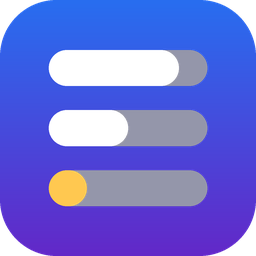
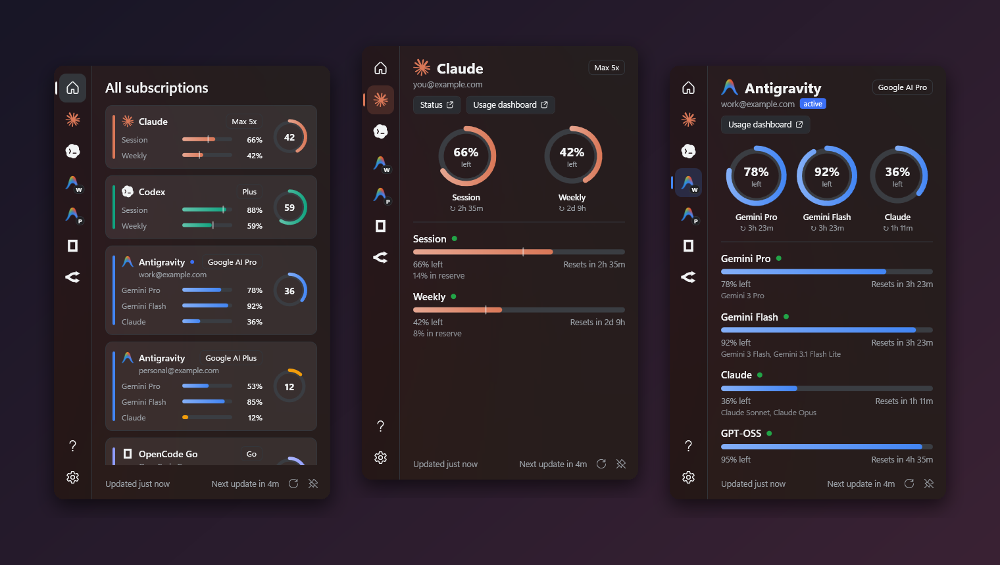
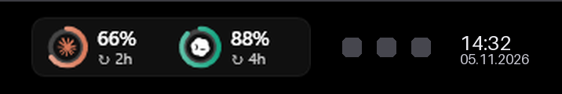
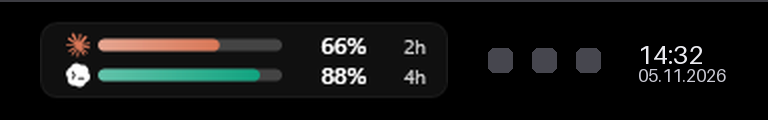
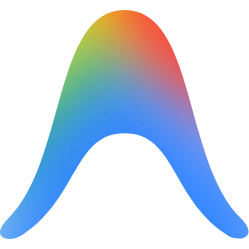
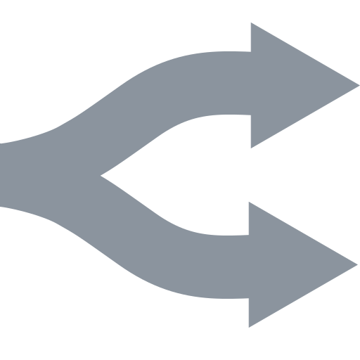
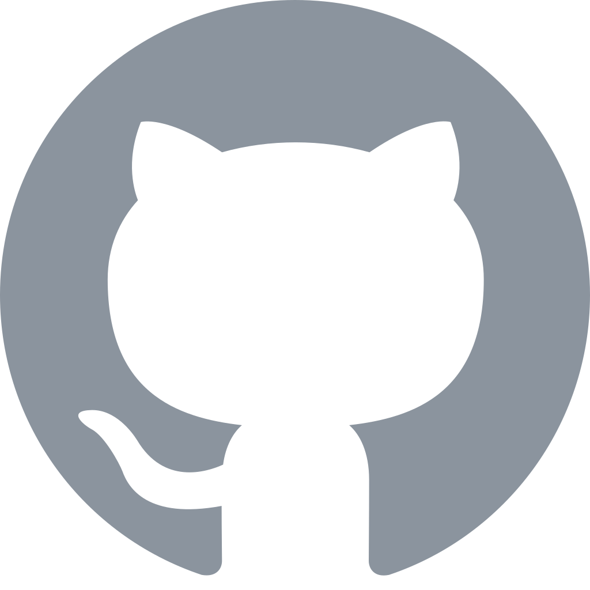
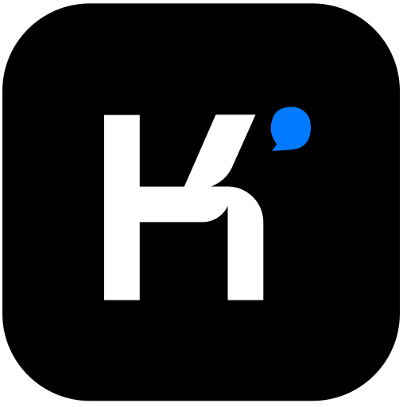
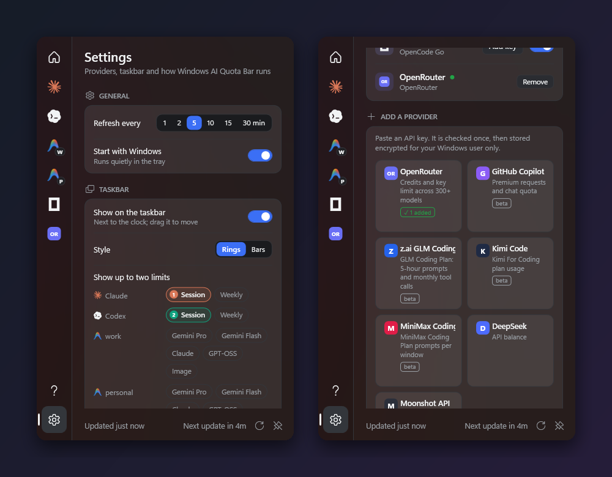

<p align="center">
  
</p>

<h1 align="center">Windows AI Quota Bar</h1>

<p align="center">
  <b>Every AI coding subscription limit, live on your Windows taskbar.</b><br>
  Claude · Codex / ChatGPT · Google Antigravity (multi-account) · OpenCode Go · OpenRouter · Copilot · and more
</p>

<p align="center">
  <a href="https://github.com/valuex-creative/Windows-AI-Quota-Bar/releases/latest"></a>
  
  
  
  <a href="LICENSE"></a>
</p>

<p align="center">
  <a href="https://github.com/valuex-creative/Windows-AI-Quota-Bar/releases/latest"><b>Download</b></a> ·
  <a href="#features">Features</a> ·
  <a href="#supported-providers">Providers</a> ·
  <a href="#ask-your-ai-assistant-mcp">MCP</a> ·
  <a href="#privacy--security">Security</a>
</p>

<p align="center">
  
</p>

<p align="center"><sub>Screenshots use the built-in demo mode (<code>QuotaBar.exe --demo</code>). All accounts and numbers are fake.</sub></p>

---

Paying for Claude Max, ChatGPT Plus, a couple of Google AI plans and an API key or two, and opening five dashboards to see what is left? **Windows AI Quota Bar** keeps every limit one glance away, right next to the clock.

## Features

<table>
<tr>
<td width="50%" valign="top">

### 🟢 Taskbar widget
Two live gauges next to the clock. Pick **rings** or **bars**, choose which two limits to show, and drag it where you like. It hides itself while a full-screen game or video is running.

</td>
<td width="50%" valign="top">

### 📊 Tray panel
Every provider on one page, with a detail page for each one: session, weekly and per-model windows, reset countdowns and **pace** (*"8% ahead of pace, runs out in 2d 4h"*). **Pin** it to keep it on screen.

</td>
</tr>
<tr>
<td valign="top">

### 👥 Multiple Antigravity accounts
See your Pro and Plus Google accounts side by side and switch the active `agy` login with one click.

</td>
<td valign="top">

### 🤖 Ask your AI assistant
Ships with `qb`, a CLI and an **MCP server**. Claude Code, or any MCP client, can answer *"how much Codex do I have left?"*

</td>
</tr>
<tr>
<td valign="top">

### ➕ Add more providers
Paste an API key for OpenRouter, GitHub Copilot, z.ai, Kimi, MiniMax, DeepSeek or Moonshot. Each key is tested once, then stored encrypted.

</td>
<td valign="top">

### 🎨 Feels native, stays current
Windows 11 Mica, rounded corners, follows light and dark mode. The UI is in English and Turkish. **Updates itself**: it shows when a new version is out and installs it in one click.

</td>
</tr>
</table>

<p align="center">
  <br>
  
</p>

## Supported providers

| | Provider | What is shown | Where the login comes from |
|:-:|---|---|---|
|  | **Claude** (Pro / Max) | 5-hour session, weekly, weekly Opus/Sonnet | Sign in to claude.ai inside the app, **or** your Claude Code CLI login |
|  | **Codex / ChatGPT** (Plus / Pro) | 5-hour session, weekly, credits | `codex login` |
|  | **Google Antigravity** | Gemini Pro, Gemini Flash, Claude, GPT-OSS, Image quotas, per account | `agy` CLI login |
|  | **OpenCode Go** | 5-hour, weekly, monthly | Keys saved by OpenCode, or added in Settings |
|  | **OpenRouter** | Credits, key limit, daily / weekly / monthly spend | API key |
|  | **GitHub Copilot** <sup>beta</sup> | Premium requests, chat quota | `gh auth token` (auto-detected) |
|  | **z.ai GLM Coding** <sup>beta</sup> | 5-hour prompts, monthly tool calls | API key |
|  | **Kimi Code** <sup>beta</sup> | Plan usage | API key |
|  | **MiniMax Coding** <sup>beta</sup> | Prompts per window | API key |
|   | **DeepSeek** · **Moonshot** | Account balance | API key |

Missing one? [Open a provider request](https://github.com/valuex-creative/Windows-AI-Quota-Bar/issues/new?title=Provider%20request%3A%20).

<p align="center">
  
</p>

## Install

### Download (recommended)

1. Download **[WindowsAIQuotaBar-Setup.exe](https://github.com/valuex-creative/Windows-AI-Quota-Bar/releases/latest)** from the latest release.
2. Double-click it. It installs for your user only, so you do not need admin rights.

That's it. The app appears next to the clock and starts with Windows (you can turn that off in Settings). Uninstall it from **Settings → Apps** like any other app.

> Windows SmartScreen may warn you because the installer is not code-signed yet. Click **More info**, then **Run anyway**.

<sub>Prefer no installer? Download the `portable.zip` from the same release, extract it anywhere and run `QuotaBar.exe`.</sub>

### Build from source

```powershell
git clone https://github.com/valuex-creative/Windows-AI-Quota-Bar
cd Windows-AI-Quota-Bar
dotnet publish src/QuotaBar.App -c Release -o "$env:LOCALAPPDATA\Programs\QuotaBar"
& "$env:LOCALAPPDATA\Programs\QuotaBar\QuotaBar.exe"
```

Building needs the [.NET 10 SDK](https://dotnet.microsoft.com/download/dotnet/10.0). `.\build-release.ps1` builds the installer and the portable zip; it also needs [Inno Setup 6](https://jrsoftware.org/isinfo.php).

### Try it without any account

```powershell
QuotaBar.exe --demo
```

Demo mode shows fake data and never reads or changes anything on your PC.

## Ask your AI assistant (MCP)

```powershell
claude mcp add --scope user quotabar -- "$env:LOCALAPPDATA\Programs\QuotaBar\qb.exe" mcp
```

Settings → **Ask your AI assistant** has a one-click button for this. Tools exposed: `get_usage`, `list_antigravity_accounts`, `switch_antigravity_account`.

## CLI

```text
qb                          # live usage for everything
qb codex --json             # one provider, machine-readable
qb --cached                 # last snapshot from the running app (no network)
qb accounts                 # Antigravity accounts (* = active)
qb switch you@example.com   # switch the active Antigravity account
```

## Privacy & security

- **No telemetry, no server of its own.** The app only talks to each provider's own API, and to GitHub to check for updates (you can turn that off).
- **It reads the logins your tools already keep on this PC.** It writes to another tool's login file only when that tool's token has expired. The refresh is locked, conflict-checked and atomic, so it cannot break a refresh the CLI is doing.
- **Everything it stores is encrypted** with Windows DPAPI for your Windows user. Your `gh` token is never copied.
- **Updates are signed.** An installer is accepted only if its ECDSA signature matches the public key built into the app. Automatic install is off by default.
- **AI assistants can only read** your usage, unless you allow account switching in Settings.

**[SECURITY.md](SECURITY.md)** lists every file the app reads or writes and every host it talks to, and shows how to verify a release yourself (hash, signature, build from source).

<details>
<summary><b>How Antigravity account switching works</b></summary>

`agy` keeps its login in Windows Credential Manager (`gemini:antigravity`). The app saves a copy of every account it sees.

- **Add account** saves the current account, signs `agy` out and opens it so you can sign in with another Google account.
- **Switch** writes the stored login back.

Restart any running `agy` sessions after switching.

</details>

<details>
<summary><b>Why does Claude sign in through a built-in browser?</b></summary>

The Claude desktop app keeps its token to itself, and claude.ai blocks plain HTTP clients. The app signs in once in an embedded WebView2 window and fetches usage through it, so it gets the same numbers as claude.ai/settings/usage.

</details>

## Project layout

```
src/QuotaBar.Core   providers, models, encrypted storage (no UI)
src/QuotaBar.App    WPF tray app, panel, taskbar widget
src/QuotaBar.Cli    qb: CLI + MCP server
```

Adding a provider means implementing `IUsageProvider` and registering it in `UsageService`. For a simple API-key provider, add an entry to `KeyProviders.Catalog`.

## Credits

Inspired by [CodexBar](https://github.com/steipete/CodexBar) for macOS.

## Disclaimer

Windows AI Quota Bar is an independent project and is not affiliated with Anthropic, OpenAI, Google, GitHub or OpenCode. It reads the same private usage endpoints those companies' own apps use, and these can change without notice.

## License

[MIT](LICENSE)
